# 🛡️ LedgerVault AI — A Local-First Receipt & Invoice Auditor for Freelancers

> **Built for Hacktoberfest Open-Source AI Challenge Week 2: Side Hustle**  
> *Tags: `#devchallenge`, `#hf26challenge`*

[](LICENSE)
[](#offline-guarantee)
[](#tax-mapping)

---

## 💡 The Problem & Solution

### The Problem
Freelancers bill **$75–$150/hour**, yet lose **4 to 8 hours every month** doing manual bookkeeping, matching receipts to client contracts, and calculating deductible tax categories. 

Furthermore, freelancers routinely sign strict **Non-Disclosure Agreements (NDAs)**. Uploading receipts with confidential client names, meeting locations, and subcontractor rates to proprietary cloud APIs (OpenAI, Anthropic, Expensify) introduces serious confidentiality concerns. Meanwhile, commercial cloud software like QuickBooks or Expensify costs **$30–$60 per month**.

### The Solution: LedgerVault AI
**LedgerVault AI** is a local-first expense and invoice auditing prototype. It extracts merchant data, dates, and itemized line items from structured records and text transcripts, and maps expenses into **IRS Form 1040 Schedule C** tax lines—all running directly on the freelancer's machine with **zero external cloud API dependence and zero per-token fees**.

- **Proposed Pricing Hypothesis**: Sells as a **$29 one-time lifetime license** or **$7/month utility**, paying for itself quickly by reclaiming billable freelance hours.

---

## 🏗️ Architecture & System Diagram

```mermaid
graph TD
    A[Freelance Receipt / Invoice] -->|Preset / Transcript / File| B[Local Ingestion Sandbox]
    B --> C{Local Processing Engine}
    
    C -->|Default Offline| D[Client-Side Rule Parser & Tax Heuristics]
    C -->|Power Mode: localhost:11434| E[Local Ollama Bridge: Llama 3.2 3B / Mistral]
    
    D --> G[Entity & Line-Item Extraction]
    E --> G
    
    G --> H[IRS Schedule C Tax Categorization Engine]
    H --> I[Deduction Limit & Audit Risk Checks]
    I --> J[Client Attribution & Billable Filter]
    
    J --> K[(Local Storage Vault)]
    K --> L[QuickBooks / Xero CSV Export]
    K --> M[Tax Schedule JSON Export]
    K --> N[Real-time Tax Savings KPI Dashboard]
    
    style C fill:#1e293b,stroke:#38bdf8,stroke-width:2px
    style D fill:#0f172a,stroke:#10b981,stroke-width:2px
    style E fill:#0f172a,stroke:#a855f7,stroke-width:2px
    style K fill:#111622,stroke:#f59e0b,stroke-width:2px
```



---

## 🌟 Key Features

1. **🔒 Verified Zero-Cloud Isolation**:
   - Bundled with local vector icon assets and system typography; no remote font or icon CDNs.
   - Built-in live privacy inspector verifying local sandbox execution and zero external telemetry.
2. **📑 Statutory IRS Schedule C Mapping**:
   - **Line 9**: Car & Truck Expenses (ordinary local transit, or Line 24a for travel away from home).
   - **Line 11**: Contract Labor (subcontractor engineering and design fees).
   - **Line 17**: Legal & Professional Services (attorney, accounting, CPA fees).
   - **Line 18**: Office Expense & Cloud SaaS (hosting, design subscriptions, tools).
   - **Line 24b**: Deductible Business Meals (automatically enforces statutory 50% IRS limitation under IRC § 274(n)).
3. **💼 Client Attribution & Billable Segregation**:
   - Easily mark client-reimbursable travel vs. internal studio overheads.
4. **⚠️ Audit Risk Checks**:
   - Identifies missing itemized breakdowns, weekend dining flags, and statutory substantiation notes.
5. **📊 1-Click Export Center**:
   - QuickBooks & Xero compatible CSV.
   - JSON export for CPA audits.
6. **🚀 Optional Local Model Bridge**:
   - Active Ollama connection detection at `http://localhost:11434/api/tags` to verify local open-weight model availability.

---

## 🚀 Getting Started

### 1. Run Locally (Zero Build Step Needed)
LedgerVault is built with clean Vanilla HTML, CSS, and modern modular JavaScript:

```bash
# Clone the repository
git clone https://github.com/FarrosIlman/LedgerVault.git
cd LedgerVault

# Start a local web server (Python, Node, or VS Code Live Server)
python -m http.server 8080
# or: npx serve .
```

Open `http://localhost:8080` in your web browser.

### 2. (Optional) Connect to Local Ollama
For users who want local open-weight inference with Llama 3.2 3B or Mistral 7B:

```bash
# 1. Install Ollama from https://ollama.com
# 2. Pull and run the model:
ollama run llama3.2:3b

# 3. In LedgerVault's engine selector, choose:
# "Local Ollama Bridge (Llama 3.2 on localhost:11434)"
```

The application will check the connection and route extraction prompts through `http://localhost:11434/api/generate` with zero data leaving your machine!

---

## 🌐 Why Open Innovation Matters

| Dimension | Proprietary Cloud Services (Expensify / Commercial APIs) | LedgerVault Local-First Architecture |
| :--- | :--- | :--- |
| **Client Privacy** | Invoices sent to remote servers (potential NDA risk) | **100% Local (0 KB network egress)** |
| **Inference Cost** | $0.05 – $0.10 per invoice token charge | **$0.00 marginal cost** |
| **Offline Capability** | Requires constant internet connection | **Runs on flights or offline client sites** |
| **Customization** | Locked to fixed vendor models | **Model freedom (Ollama, Llama 3.2, Mistral)** |
| **Pricing Model** | $30 – $60/month subscription | **Local-first utility** |

---

## ⚠️ Disclaimer
LedgerVault AI is designed for freelance recordkeeping and expense organization. IRS Schedule C classifications, deductibility rates, and tax savings are estimates based on standard statutory rules (e.g. IRC § 274(n) 50% meals limitation) and do not constitute certified tax, accounting, or legal advice.

---

## 📄 License
This project is licensed under the [MIT License](LICENSE).
